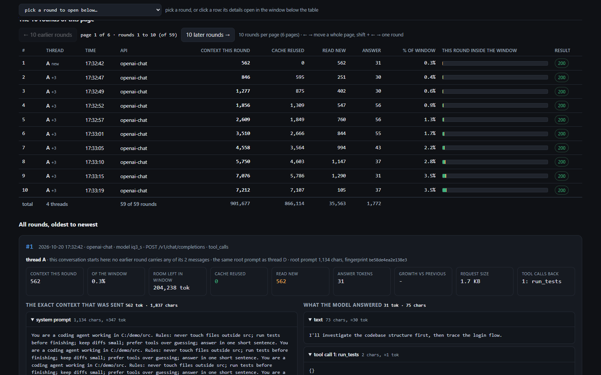

# Watching the context that goes to Strata

A logging proxy plus report tools for seeing exactly what each coding agent sends
to a local Strata model on every round - the full prompt, the full answer, and the
token statistics (Strata's own counts: context read, prompt-cache reuse, new
tokens, answer tokens, share of the context window).



Nothing is capped at a fixed number of rounds: the log keeps every request until
you delete it, and the page renders every round in it.

The rounds are also grouped into conversations, so you can see which of them came
from the same session, which ones ran on the same root prompt, and where a root
prompt or a tool set changed part way through.

Needs only Python 3 (standard library) and PowerShell. Nothing leaves the machine:
the proxy talks to Strata on loopback only.

## Quick start

Run these from this folder (`C:\Local Model\Context Monitor`).

### 1. Start the capture

Strata has to be running first. Then:

```powershell
.\Start-ContextMonitor.ps1
```

It finds Strata's current port by itself, starts the logger on port **8788**, and
prints what it picked:

```
context logger (pid 17472): http://127.0.0.1:8788  ->  http://127.0.0.1:47831
logs: C:\Local Model\Context Monitor\logs
point your agent at  http://127.0.0.1:8788/v1   (Claude Code: ANTHROPIC_BASE_URL=http://127.0.0.1:8788)
```

If it says a logger is already running there, it is - it refuses to start a second
one. Pick the target yourself when you run Strata on a fixed port or on a
different one:

```powershell
.\Start-ContextMonitor.ps1 -Upstream http://127.0.0.1:8080
.\Start-ContextMonitor.ps1 -Live          # also opens the live command-line view
.\Start-ContextMonitor.ps1 -Port 9099     # different logger port
```

Now point the agents at the logger instead of at Strata. They keep working
normally; every round they make is written to disk as it happens.

| agent | base URL to use |
|---|---|
| OpenAI-compatible (OpenCode, Cursor, Continue, anything with a custom base URL) | `http://127.0.0.1:8788/v1` |
| Claude Code | `$env:ANTHROPIC_BASE_URL = "http://127.0.0.1:8788"` |
| Codex CLI | `model_base_url = "http://127.0.0.1:8788/v1/responses"` in `config.toml` |

Check that traffic is landing, in another window:

```powershell
python ctxview.py list      # one line per round, with Strata's exact counts
python ctxview.py live      # keep printing each new round
```

Or ask the logger directly: `Invoke-RestMethod http://127.0.0.1:8788/ctx-stats`.

### 2. Stop the capture

```powershell
Get-CimInstance Win32_Process -Filter "Name='python.exe'" |
  Where-Object { $_.CommandLine -like '*context_proxy.py*' } |
  ForEach-Object { Stop-Process -Id $_.ProcessId }
```

If you started it in a window you can see (`-Live`, or running
`python context_proxy.py` yourself), `Ctrl+C` in that window stops it too.

Stopped means the port is free again: `Invoke-RestMethod http://127.0.0.1:8788/ctx-stats`
refuses to connect, and `python ctxview.py list` stops growing. Strata itself keeps
running - point the agents back at Strata's own port whenever you want the logger
out of the path, and they work exactly as before. The log stays on disk, so the
page still opens afterwards. To start from an empty log: stop the logger and
delete the `logs` folder.

### 3. Open the round page

```powershell
python ctxpage.py --md report.md
Start-Process report.html
```

That writes `report.html` - one offline file, no server, no network - and opens it
in your browser. It holds **every** round currently in the log, not the last 50.

Keep it updating while you capture instead of re-running it:

```powershell
python ctxpage.py --watch --md report.md    # rewrites the page every 3s, Ctrl+C to stop
```

In the page:

- The table shows **10 rounds per page** and stays on screen. `← 10 earlier
  rounds` / `10 later rounds →` move a whole page; arrow keys do the same, and
  shift + arrow steps a single round. `--page-size 25` changes how many per page.
- Per round: **context this round** (Strata's count; `est` only when no count came
  back), **cache reused**, **read new**, **answer** tokens, **% of window**, a bar
  of that round inside the window (green = already in the prompt cache, orange =
  read new, red if a context ever exceeds the window) and the HTTP result. The
  largest context gets a `biggest` badge, and the last row totals the rounds.
- **Pick a round** from the list at the top, or click its row: the table stays
  exactly where it is and the round opens in a **Selected round** window below it,
  with all rounds still listed underneath. Choosing the empty entry closes the
  window; picking a round that lives on another page switches the table there.
- Each card: growth since the previous round, room left in the window, request
  size and the tool calls back; and side by side **the exact context that was
  sent** (system prompt, tool definitions, every message including tool results)
  and **what the model answered** (text, thinking, tool calls with their
  arguments). Each column header carries its own total - `35,215 tok · 130,091
  chars` beside `39 tok · 405 chars` - and every block shows its characters next
  to its tokens. Long blocks fold open and closed, and the card names the payload
  file holding the uncut text.


Other page options:

```powershell
python ctxpage.py --max-chars 40000     # more text inline per block
python ctxpage.py --max-context 32768   # force the window instead of reading it
python ctxpage.py --last 200            # only the newest 200 rounds in the table
```

The page reads the window size from Strata's own run config (`--max-context
204800` in `strata-iq3_s.json`) and states it once in the header; the table's
percentages and bars are each round against that window.

From a 50-round test run against a 204,800-token window:

```
#    time     api          context this round  reused   new  answer  % of window
1    17:32:42 openai-chat  562                0        562  31      0.3%
10   17:33:19 openai-chat  7,212              7,107    105  37      3.5%
50   17:35:43 openai-chat  35,215 (biggest)   34,511   704  39      17.2%
```

## Which rounds belong to the same conversation

An agent that keeps a conversation going sends the whole history again on each
turn, so rounds can be tied together by what they carried. `ctxlink.py` hashes
every request's message list: the hash of its first *k* messages, in order
(tool-call ids are normalised away, so a re-issued call does not break a chain).
A round whose history starts with an earlier round's entire history continues
that round, and the newest match wins - so a retried turn hangs off the round it
retried instead of starting a conversation of its own.

The root (system) prompt and the tool definitions are hashed on their own, and a
second chain is kept over the conversation with the leading system messages
removed. That is what makes the useful things visible:

- **the same conversation** - each round names the round it continues, how many
  messages were shared with it and how many were new;
- **the same root prompt across different conversations** - two agents running
  with identical instructions but unrelated histories stay separate, and each
  reports "the same root prompt as thread A";
- **a root prompt that changed mid-session** - the history still matches while
  the root-prompt fingerprint does not, and that round says so;
- **retries and forks** - rounds that sent identical history point at each other,
  and a round that more than one round continues gets called out;
- **who sent it** - the user agent and any app / session headers on the request.

The page shows this three times: a conversations table at the top, a thread
column in the round table (`A`, with `+3` meaning three messages added since the
round it continues, `again` meaning the same history went out again, `new`
meaning a conversation starts there), and one line under every round's number.


From the command line:

```powershell
python ctxview.py sessions           # one block per conversation
python ctxview.py sessions --rounds  # ...and which rounds are in each
python ctxview.py show 53            # one round, with where it came from
```

A log with four pretend conversations - two sharing a root prompt, one retried
turn, one root prompt that changes half way through - is one command away:

```powershell
python demo_threads.py               # writes sample rounds into logs\
python ctxview.py sessions
```

Some Responses-API clients continue a conversation with `previous_response_id`
instead of resending it; those chain by the answer id the logger recorded. If the
logger has been running since before that was added, stop it and start it again.


## What the logger writes

`context_proxy.py` sits between your agents and Strata and forwards everything
unchanged - streaming, tool calls, thinking levels - while writing every round:

- `logs\requests.jsonl`: one line per request and per answer (model, API shape,
  estimated system / history / tool-definition tokens, the real `usage` from
  Strata, finish reason). Keys are masked.
- `logs\payloads\req-NNNNNN.json`: the full request body, so the exact context can
  be read back.
- `logs\payloads\resp-NNNNNN.txt`: the answer, captured while it streams - text,
  thinking, tool calls - so a model restart does not lose it.

Reading it later from the command line:

```powershell
python ctxview.py list            # one line per round: thread, context, Strata's own counts
python ctxview.py sessions        # those rounds grouped into conversations
python ctxview.py show 42         # the whole context of request 42, message by message
python ctxview.py diff 42 43      # what grew between two turns of the same agent
python ctxview.py stats           # totals, prompt-cache reuse, the biggest context
```

`ctxview.py stats` ends with the window: `context window: 204,800 tokens (Strata's
run config strata-iq3_s.json); the biggest round filled 17.2% of it, 169,585
tokens of room left`. `ctxview.py diff 49 50` says which part grew - system prompt,
history, tool results, tool definitions - and how much of the request was an
unchanged prefix. Claude Code, Codex and plain OpenAI-style requests are all
recognised.

## How the token numbers are worked out

The context, reuse and answer figures come from Strata's own `usage` counts, so
they are exact whenever Strata reports them (its OpenAI-compatible route does; the
Anthropic-shaped route does not report cache reuse, which is why that column can
show `-`). The tokens shown per block are Strata's count for that round shared out
over the blocks by size, so the blocks add up to the round's total instead of being
separate guesses. Only where no count came back does the page fall back to
characters, and it marks those `est`. That fallback is worth little on its own: in
one test run the same model measured ~7.9 characters per token on repeated
boilerplate, ~3.1 on prose and code, and ~2.5 on Claude-shaped JSON.

## Which port Strata is on

The Strata **app** listens on a **random loopback port that changes every time it
starts** - during this run `http://127.0.0.1:47831/v1` (its own internal server
answers on a second port, 18500, with an API key). Nothing here hard-codes 8080.

```powershell
.\find-strata-port.ps1            # prints the port
.\find-strata-port.ps1 -Detailed  # port, model, process, pid
```

(`run-iq3_s.bat` from the Terminal is the fixed-port alternative:
`C:\Users\v-gulin\AppData\Local\Strata\install\strata-iq3_s.json`, port 8080.)

## Strata's built-in inspector, instead of this proxy

Your build can keep the last 100 requests **with their full prompts and answers**
and show them on a page: the `api_monitor` option. It is off here, which is why
`http://127.0.0.1:47831/api/requests` answers 404. To use it:

- `"api_monitor": true` in the run config (`strata-iq3_s.json` on the Terminal
  route), or `--api-monitor` where the server is started, or the **Settings, Model
  settings** card in the web page;
- restart the model, then open `http://127.0.0.1:<port>/api-monitor`: one row per
  agent request, each row's **Input** being the exact context the agent sent -
  system prompt, whole history, tool results, tool definitions - beside Output,
  Reasoning, the raw response, prompt tokens and timings;
- for scripts: `GET /api/requests` (list) and `GET /api/requests?id=<id>`.

Last 100 requests, **memory only** (gone after a model restart), each cut at
262,144 characters: good for spot checks, not for tracking a whole session. The
ordinary Monitor and `strata monitor` / `strata logs` never show prompt text, by
design. `GET /slots` gives the running request's `n_prompt_tokens` for a context
meter (over `n_ctx`).

## Space

Every request body is kept under `logs\payloads`, so the folder grows with your
session - a busy agent run is a few MB per hour. `--store-max-bytes 2000000` caps
each stored payload (default 2 MB); `--port 8788 --upstream <url> --dir logs` are
the other options. Stop the logger and delete `logs` to reclaim the space. If
Strata is not reachable the logger answers 502 and logs that, so you notice.
