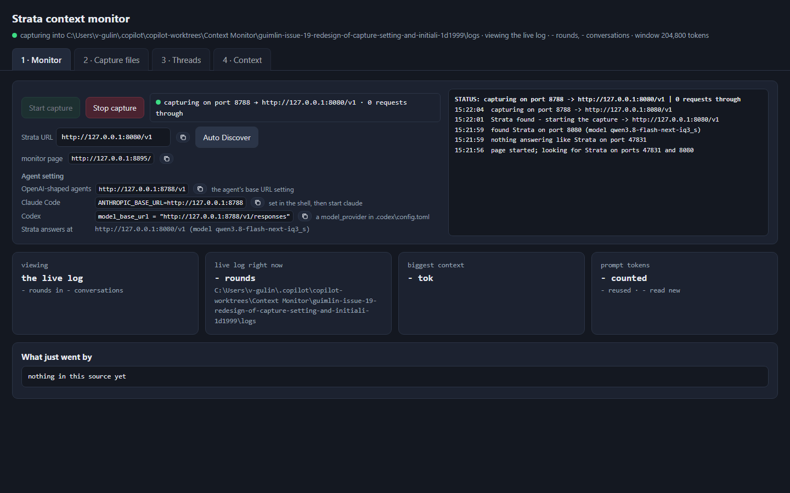
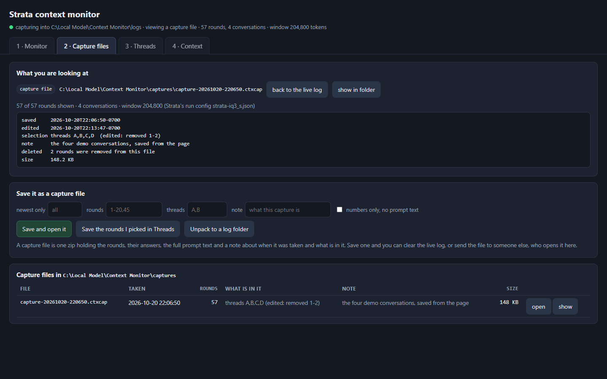
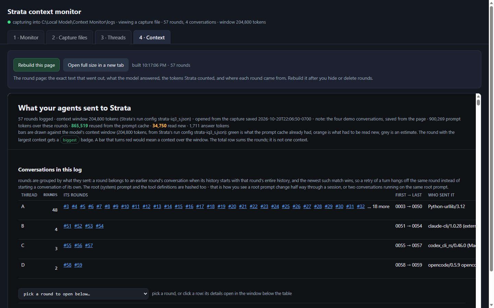
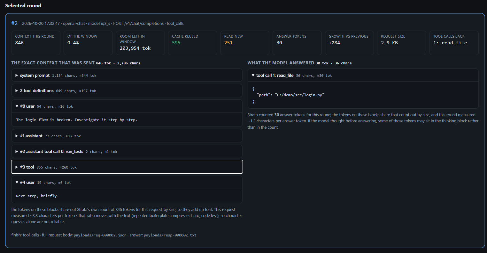
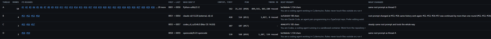
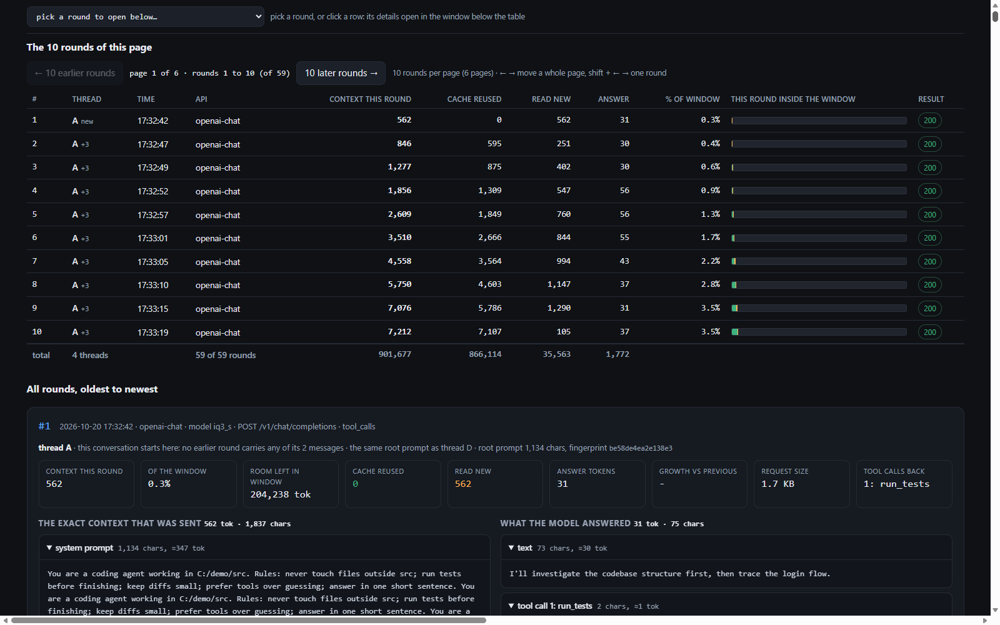

# Watching the context that goes to your model

One page that sits between your coding agents and a local model server and shows
exactly what each agent sent on every round - the whole prompt, the whole answer -
beside the token figures the server itself counted: context read, prompt-cache
reuse, tokens read new, answer tokens, and how much of the context window each
round filled. The rounds are also grouped into conversations, so you can see which
of them came from the same session, which ran on the same root prompt, and where a
root prompt or a tool set changed part way through.



There is one command, and it is the one that opens the page. Start the capture,
save a capture file, open one again, hide rounds, delete rounds out of a capture
file, and read the context of any round: all of that is a button in the page.

Nothing is capped at a fixed number of rounds - the log keeps every request until
you delete it. Needs only Python 3 (standard library) and PowerShell. With a local
model server nothing leaves the machine: the page and the capture talk to it on
loopback only. Pointing the capture at a cloud API you reach with an API key instead
(see *Capturing an API key: a cloud API over https*) sends that traffic to the
provider, as it would anyway. Either way, API keys are masked before anything is
written down.

## Quick start

Run this from this folder (`C:\Local Model\Context Monitor`), with the model
already running:

```powershell
.\Start-ContextMonitor.ps1
```

It opens `http://127.0.0.1:8790/` in your browser and prints the ports:

```
context monitor page (pid 17472): http://127.0.0.1:8790/
capture port for agents: http://127.0.0.1:8788/v1   (Claude Code: ANTHROPIC_BASE_URL=http://127.0.0.1:8788)
```

Then, in the page:

1. the page goes looking for a model server the moment it opens - it tries the ports
   one has been seen on here (47831 and 8080) first, then the other loopback
   listeners - and when one answers like a model server it starts the capture by
   itself;
2. point an agent at the capture (the page prints the URL for each kind of agent);
3. watch the rounds arrive line by line, and read them on tab 3, Context.

| agent | base URL to use |
|---|---|
| OpenAI-compatible (OpenCode, Cursor, Continue, anything with a custom base URL) | `http://127.0.0.1:8788/v1` |
| Claude Code | `$env:ANTHROPIC_BASE_URL = "http://127.0.0.1:8788"` |
| Codex CLI | `model_base_url = "http://127.0.0.1:8788/v1/responses"` in `config.toml` |

The agents keep working normally: the capture copies the traffic and forwards it
untouched, streaming and tool calls included. Stopping the capture puts the model
server back in the path exactly as it was; the rounds already captured stay
readable.

Other page options from the command line, if you want them:

```powershell
.\Start-ContextMonitor.ps1 -CapturePort 9001    # the port agents point at
.\Start-ContextMonitor.ps1 -Port 8899           # the page on another port
.\Start-ContextMonitor.ps1 -Upstream http://127.0.0.1:8080
.\Start-ContextMonitor.ps1 -Upstream https://api.openai.com/v1   # a cloud API, by key
.\Start-ContextMonitor.ps1 -NoWindow            # start it, open the browser later
```

The capture listens on the port it was started with, and the page has no box to move it:
pick that port when you start the page, with `-CapturePort` above (or `--proxy-port` on
`ctxweb.py`), and every URL on the page follows it.

## Tab 1 - Monitor: start and stop the capture

The top card holds **Start capture** and **Stop capture** on the first line, with the
capture's own status box beside them: the port it listens on, the URL it forwards to,
and how many rounds have gone through. When nothing is answering at that URL - you
typed one, or the model moved - the box turns amber, says so, and names where a model
server was found instead. Under them a **Model URL** box and **Auto Discover**: the box
holds the URL the capture forwards to - the one that was found, or
`http://127.0.0.1:8080/v1` when nothing was.
Type your own and it is used when you start the capture; **Auto Discover** looks
again and fills the box with what it finds. A copy icon beside the box puts whatever
is in it on the clipboard. The next line is the page's own URL, clickable and with its
own copy icon, which is what an agent's browser tools are pointed at, and under it
**Agent setting**: the URL each kind of agent uses - OpenAI-shaped, Claude Code, Codex -
each with its own copy icon, plus a line saying where the model answers. Beside all of
that is the
**status and discovery log**: what the page looked for, what it found, which port it
started capturing on, and what went wrong when something did not - newest entry first.

The capture listens on the port the page was started with (8788 unless `-CapturePort`
said otherwise), and the page keeps its status box, its URLs and its agent settings
pointed at that one port. If something else is already listening there, **Start
capture** refuses and says to start the page with `-CapturePort` on another port. A
capture answering on that port but started somewhere else (the command line, another
page) is taken over instead: the page reports it as running and **Stop capture** stops
it too.

Below the card: a **Monitor pages running on this machine** card - the list of every
page that is up right now, each with its port, its URL (clickable, to open that page),
and its pid, with a **stop** button on each row and a **refresh the list** button on top.
Start the page twice by accident, or on two ports, and this is where you see both and
close the one you do not want; the row of the page you are reading is marked *this page*,
and stopping it closes that tab (a capture it started keeps running, as always). The list
is read when the tab opens and when you press refresh, not on the 4s poll, because the
scan costs a process query.

Below that card: rounds in what you are viewing, how many rounds
the live log holds right now, the biggest context so far as a share of the window,
and how many prompt tokens were reused from the cache against how many were read
new. Then a tail of the rounds going by - one line each, request and answer, each one
stamped with the date and time it went by (`mm/dd/yyyy hh:mm:ss`), so a round from
yesterday is not mistaken for one from today.

The capture only writes down calls that ask the model for something. The model
server's own page, its fonts and its `/api/` calls come through the same port when you
happen to open the app through the capture; those are skipped, so the rounds are not
buried.

## Tab 2 - Capture files: save one, open one



The top card says what you are looking at - the live log folder, or a capture file
- with its path, how many rounds and conversations are in it, which ones the page
is hiding, and which context window it was taken against.

**Save it as a capture file** writes the rounds you name into one file:

- **newest only** - just the last N rounds;
- **rounds** - a range like `1-20,45`;
- **threads** - whole conversations, by the name the Context page's thread table
  calls them
  (`build-failing-node`, or the start of a name as long as it points at one);
- **note** - a line that travels with the file;
- **numbers only, no prompt text** - skip the payload files, which makes the file
  tiny and keeps the statistics.

A capture file (`capture-20261020-220650.ctxcap`) is one zip holding the event
lines, the full prompt text and the answers, plus a `manifest.json` that says when
it was taken, what was selected, which window it was measured against, and the
totals. Everything in the page works the same on a capture file as on the live
log, and the header of the round page says where it came from:

```
57 rounds logged · context window 204,800 tokens (the model's run config strata-iq3_s.json)
  -  opened from the capture saved 2026-10-20T22:06:50-0700
     note: the four demo conversations, saved from the page
```

That is how you move a session to another machine, or hand it to someone else:
save the file, copy it across, and they open it here - **Open** in the list of
capture files. **Unpack to a log folder** turns a capture back into a plain log
folder if you want the raw files, and **show in folder** opens Explorer at the
file. **back to the live log** puts you back on what the capture is writing now.

## Tab 3 - Context: the exact context of each round



The Context tab is the round page, built for whatever you are currently viewing
and with the hidden rounds left out. **Open full size in a new tab** gives the same
page on its own, and the round table's **open** links jump straight into it.
Hiding, showing again or deleting rounds from part 1 rebuilds this page and refreshes
the monitor page around it by itself; **Rebuild this page** does the same by hand.

- The page is split into **four numbered parts**: **1 Threads** (the conversations),
  **2 Rounds** (the table and its paging), **3 Round details** (the round you picked,
  in full - the page opens it on the first round of the table, so it is never an empty
  box waiting for a click) and **4 All rounds** (every round card
  the page holds).
- **1 Threads** is one row per conversation: its name - a few words out of the first
  thing a person typed there, so the build conversation is `build-failing-node` rather
  than `B` - how many rounds it holds and which ones, the client that sent it
  (`claude-cli/1.0.9`, `codex_cli_rs/0.46.0`, and any session headers), the context of
  its first round and its biggest round, the tokens it sent, the first thing a person
  asked there, its root prompt's fingerprint and length, and what changed along the way
  - a root prompt that changed, tool definitions that changed, a history sent out
  twice, a round that forked, or another conversation sharing the same root prompt.
  Hold the mouse over a prompt and a floating box opens with the whole of it, titled
  with where it came from; past 4,000 characters the box shows the first 4,000 and says
  how long it really was. Only what a person typed goes in that box - system
  instructions, tool definitions and tool results never do. The list is five
  conversations tall and scrolls, with its header held at the top, so a hundred
  threads still leave the rest of the page in view.
- Tick a thread's box - it stands in for every round that conversation is made of -
  and the tools above the table act on those rounds:
  - **hide from view** - the page stops showing them, in the threads table, in the
    rounds table and in every part below. Nothing is removed, and **show hidden
    again** puts them back. Which rounds are hidden is remembered per source, in
    `hidden.json`.
  - **delete from the capture file** - rewrites the capture file without those rounds
    and their answers and payload files. The file as it was is kept beside it as
    `NAME.ctxcap.bak-20261020-221347`, and the manifest records what was removed and
    when. The button is disabled while you are looking at the live log, because the
    capture is still writing it - save a capture first, then edit that.
  - **save the threads I picked to a capture file** - writes just those conversations
    into a new capture file, the same selection the **threads** box on the Capture tab
    takes.
  - **select every thread / unselect every thread** - for the whole list at once.
  - A conversation whose rounds are all hidden or deleted is off the page entirely:
    threads are worked out from the rounds that are left, so an empty one is not
    listed and its name stops turning up in the filters.
- The header figures are **KPI cards**, one per figure: rounds logged, the context
  window the page measures against, prompt tokens, cache reused, read new and answer
  tokens. The cache figures are coloured green and orange, the same two colours the
  bars use; what the capture covers is a small note under the cards rather than a
  sentence of numbers.
- The table holds **10 rounds per page** and stays put. `10 earlier rounds` /
  `10 later rounds` move a whole page; arrow keys do the same, shift + arrow steps
  one round. A picker above it lists every round, prefixed by its thread name. The page
  opens with the first round of the table already picked, so **3 Round details** holds a
  round from the start instead of staying hidden until you click one.
- **show only** beside that picker filters the Context page by conversation: pick a
  thread and the table, its paging and the picker keep just that thread's rounds
  (the pager says how many are left); pick **all threads** to put every round back.
  The threads are listed by their names, the same words the cards call them by.
  A thread the filter leaves out is still in the page - the round cards below and the
  conversations table above are never filtered. If the filter takes away the round
  **3 Round details** was showing, it opens on the first round the filter leaves in view
  rather than blanking out.
- Per round: **context this round** (the model's own count; `est` only when no count
  came back), **cache reused**, **read new**, **answer** tokens, **% of window**, a bar
  for that round inside the window (green = already in the prompt cache, orange =
  read new, red if a context ever exceeds the window), the thread it belongs to -
  its cell shows what the person asked that round, and hovering it opens the
  whole prompt - and how it connects, and the HTTP result. One line under the
  heading of part 2 explains those bars: what they are drawn against, what each
  colour means, the `biggest` badge, and that the total row sums the rounds rather
  than measuring one context.
- Each round's card shows side by side **the exact context that went out** -
  system prompt, tool definitions, every message including tool results - and
  **what the model answered**: text, thinking, tool calls with their arguments.
  Both columns carry token counts as well as characters, long blocks fold, and the
  card names the payload file holding the uncut text.
- **Every block starts shut** - the system prompt, every message, the thinking, the
  answer text and the tool calls - so a page of rounds stays short and skimmable.
- **A shut round of part 4 is one row**, not an empty card: with every block of a
  round shut, the card shrinks to a single row of its key columns - the thread, the
  context this round, its percent of the window, cache reused, read new, answer
  tokens, the bar and the HTTP result - next to its number and its two buttons. Open
  any block and the card grows back into the full card; shut them all again and it
  folds back to that row. The round you picked in part 3 always shows in full,
  whatever its blocks are doing.
- **expand all / collapse all**, at the top of **4 All rounds**: one click opens every
  block of every round card on the page, the next click folds every card back to its
  one row of key columns.
- **expand/collapse icon**, in the head of every round card and left of the copy icon:
  one click opens every block of that round - the system prompt, every message, the
  thinking, the answer text, the tool calls - and the next click shuts them all again.
  The corners reach out while any block is still shut and pull in once every block of
  the round is open, and the button reads what the blocks are really doing, so opening
  or shutting one of them by hand keeps the icon and its name honest. The part-wide
  button reads the same way: shut one round by hand and it asks to `expand all` again.
- **copy icon** (the same one the monitor page uses), in the head of every round card
  and so in the selected-round window below
  the table too, puts the round on the clipboard as plain text: every field the page
  holds - the thread and how the round connects, what the person asked this round, who
  sent it, the time, api, model,
  request, HTTP result, finish, context this round, the window it was measured against,
  percent of it, room left, cache reused, read new, answer tokens, growth, characters,
  messages, tool definitions, root prompt fingerprint, request size, tool calls back,
  and the payload files holding the uncut text - and then every block of context and
  the answer, cut at the same length the page shows them. Paste it into a note, an
  issue, or a text file.



The page reads the window size from the model's own run config (`--max-context
204800` in `strata-iq3_s.json`), or from the capture file you opened, and states it
in a KPI card of the header; every percentage and bar is that round against that
window.

## How conversations are worked out

An agent that keeps a conversation going sends the whole history again on each
turn, so rounds can be tied together by what they carried. `ctxlink.py` hashes
every request's message list: the hash of its first *k* messages, in order
(tool-call ids are normalised away, so a re-issued call does not break a chain). A
round whose history starts with an earlier round's entire history continues that
round, and the newest match wins - so a retried turn hangs off the round it
retried instead of starting a conversation of its own.

The root (system) prompt and the tool definitions are hashed on their own, and a
second chain is kept over the conversation with the leading system messages
removed, which is what makes the useful things visible:

- **the same conversation** - each round names the round it continues, how many
  messages were shared with it and how many were new;
- **the same root prompt in different conversations** - two agents running on
  identical instructions but unrelated histories stay separate, and each reports
  "shares its root prompt with thread build-red";
- **a root prompt that changed mid-session** - the history still matches while the
  root-prompt fingerprint does not, and that round is marked;
- **retries and forks** - rounds that sent identical history point at each other,
  and a round that more than one round continues gets called out;
- **who sent it** - the user agent and any app / session headers on the request.

Each conversation is then given a name to be called by: a few words out of the first
thing it asked for, with the clients' `<system-reminder>` / `<env>` blocks and the
filler words dropped, so the build conversation is `build-failing-node` and the CLI
one is `add-dry-run-flag`. A conversation that opens with only tool output falls
back to its root prompt, then to the client that sent it, then to a number, and two
conversations that open with the same words get `-2` on the second. Thread filters
take those names, case-insensitive, and the start of a name is enough as long as it
points at one conversation; a name that matches nothing says what the log does hold.




Some Responses-API clients continue a conversation with `previous_response_id`
instead of resending the history; those chain by the answer id the capture
recorded. If the capture has been running since before that was added, stop it and
start it again.

To see the grouping on traffic you did not run: `python demo_threads.py` writes
four pretend conversations into `logs\` - two sharing a root prompt, one retried
turn, one root prompt that changes half way through - and the thread table on the
Context tab will show all of it.

## What the numbers mean

The context, reuse and answer figures come from the model's own `usage` counts, so
they are exact whenever the server reports them: its OpenAI-compatible route does,
the Anthropic-shaped route does not report cache reuse, which is why that column can
show `-`. The tokens shown per block are the model's count for that round shared out
over the blocks by size, so the blocks add up to the round's total rather than
being separate guesses. Only where no count came back does anything fall back to
characters, and it is marked `est`. That fallback is worth little on its own: in
one test run the same model measured ~7.9 characters per token on repeated
boilerplate, ~3.1 on prose and code, and ~2.5 on Claude-shaped JSON.

From a 50-round test run against a 204,800-token window:

```
#    time     api          context this round  reused   new  answer  % of window
1    17:32:42 openai-chat  562                0        562  31      0.3%
10   17:33:19 openai-chat  7,212              7,107    105  37      3.5%
50   17:35:43 openai-chat  35,215 (biggest)   34,511   704  39      17.2%
```

## What is written on disk

```
logs\requests.jsonl            one line per request and per answer: model, API shape,
                               estimated system / history / tool-definition tokens, the
                               real usage from the model, finish reason, answer id. Keys
                               (authorization, x-api-key, api-key) are masked.
logs\payloads\req-NNNNNN.json  the full request body, so the exact context can be read back
logs\payloads\resp-NNNNNN.txt  the answer, captured while it streams: text, thinking, tool
                               calls - so a model restart does not lose it
captures\*.ctxcap              capture files saved from the page
web\report.html                the Context page the page builds
hidden.json                    which rounds each source is hiding from the view
```

None of that is committed to git. The payloads are the bulk of it, so the folder
grows with your session - a busy agent run is a few MB per hour. To start from an
empty log: stop the capture and delete the `logs` folder. To reclaim space but keep
the statistics, save a capture with **numbers only** and delete `logs\payloads`.
If the model server is not reachable, the capture answers 502 and writes that down, so
you notice rather than lose the round silently.

## Under the page

The page is the whole tool, and the launcher is the only thing you need to run.
Start the capture, save and open capture files, hide rounds, delete rounds out of a
capture file, group the rounds into conversations and read the exact context of any
round: every one of those is a button in the page, and there is no separate command
to learn for any of them.

What sits under the page, if you want to read how it works:

- `ctxweb.py` - the page itself, and the only thing the launcher starts; it finds
  the model server's current port, starts capturing by itself when it finds one, and
  drives everything below;
- `context_proxy.py` - the capture: it copies the traffic, writes it down with the
  keys masked, and forwards it untouched, streaming and tool calls included;
- `ctxpage.py` - builds the round page: the one on tab 3, and the standalone
  `web\report.html` the page writes beside it;
- `ctxstore.py` - the capture-file format: writing a file, reading one back, listing
  them, and editing one (deleting rounds, remembering which are hidden);
- `ctxlink.py` - works out which rounds are one conversation, and where each round
  came from;
- `demo_threads.py` - four pretend conversations, to try the grouping on traffic you
  did not run.

`ctxstore.py` and `ctxlink.py` are imported by everything else. A capture file
stays readable by whoever has this folder - the format is a zip with a manifest
that says what is in it.

`python test_ports.py` runs the tests for the capture's port: that it is the port the
page was started with, that a port in a request cannot move it, and the guards around a
port something else already holds.
`python test_discovery.py` runs the tests for finding a model server: the ports it is
looked for on, the auto-start when one answers, the URL box and what it refuses, and
Auto Discover.
`python test_proxy_headers.py` runs the tests for what the capture sends upstream and
where it sends it: the headers it keeps and drops, the API keys it masks, and the http
and https upstreams (a cloud API behind an API key is reached over TLS).
`python test_capture_format.py` runs the tests for the capture file itself: what a
saved file says it is, and that files saved under the name this tool used before the
generic wording still open.

## Which port the model server is on

A model server listens on whatever port it was started with. The app on this machine
listens on a **random loopback port that changes every time it starts** - during this
run `http://127.0.0.1:47831/v1` (its own internal server answers on a second port,
18500, with an API key). The page looks for it in a fixed order: first the ports one
has been seen on here, **47831** (this machine's app) and **8080** (the fixed-port
run config below), then every other loopback listener. Each one is asked `/v1/models`,
and the one that answers with a list of models is the model server; the capture
recognises itself by `/ctx-stats`, so it is never picked as one.

When nothing answers, the URL box still holds `http://127.0.0.1:8080/v1`, nothing
is started, and the status log says what was tried - start the model, then press
**Auto Discover** or **Start capture**. `-Upstream` to the launcher pins the URL
instead, and then the page uses that rather than looking.

(`run-iq3_s.bat` from the Terminal is the fixed-port alternative on this machine:
`C:\Users\v-gulin\AppData\Local\Strata\install\strata-iq3_s.json`, port 8080.)

## Capturing an API key: a cloud API over https

The capture also works when the agent talks to a provider it authenticates to with an
**API key** - OpenAI, Anthropic, or any https server - rather than to a local model
server. Point the capture at the provider's https URL and it forwards over TLS; the
agent keeps its key exactly where it keeps it today:

```powershell
.\Start-ContextMonitor.ps1 -Upstream https://api.openai.com/v1    # OpenAI, Codex
.\Start-ContextMonitor.ps1 -Upstream https://api.anthropic.com    # Claude Code
```

or type the same URL into the page's **Model URL** box and press **Start capture** -
the box takes `https` as well as `http`. A URL named with `-Upstream` is used as it
stands: the page does not go sweeping loopback for a server you have already pointed
it at. Then point the agent at the capture as usual, with its key in its own
environment (`OPENAI_API_KEY`, `ANTHROPIC_API_KEY`, the agent's own login):

| agent | base URL for the agent | upstream the capture forwards to |
|---|---|---|
| OpenAI-compatible | `http://127.0.0.1:8788/v1` | `https://api.openai.com/v1` |
| Claude Code | `$env:ANTHROPIC_BASE_URL = "http://127.0.0.1:8788"` | `https://api.anthropic.com` |
| Codex CLI | `model_base_url = "http://127.0.0.1:8788/v1/responses"` | `https://api.openai.com/v1` |

The agent reaches the capture over plain HTTP on loopback, and the capture re-opens
that connection in TLS to the provider. Everything else behaves the same as with a
local server: streaming, tool calls, the usage figures the provider reports, the full
prompt and answer payloads, and the conversation grouping.

About the key itself:

- the `Authorization`, `x-api-key` and `api-key` headers ride upstream **untouched** -
  that is what makes the call work - and are written down as `<masked>`, so the key
  never lands in `requests.jsonl`, a capture file, or a round page;
- the prompts and answers are written down as always, so a capture of cloud traffic
  holds your real context: handle those files as you would the context itself;
- the provider's certificate is verified, so the capture cannot be quietly pointed at
  an imposter; a local server that only speaks https with a self-signed certificate is
  not trusted that way - reach it over http, or install its certificate;
- auto-discovery only sweeps loopback, so a cloud URL is one you name (`-Upstream` or
  the URL box), and the status box has no opinion on whether `api.openai.com` is
  answering - it cannot probe it. A round that fails still shows its HTTP result, and
  a provider that cannot be reached at all answers 502, written down like any round.

## The model server's own inspector, instead of this capture

The server you point the capture at may keep the last 100 requests **with their full
prompts and answers** and show them on a page. On this machine's app that is the
`api_monitor` option. It is off here, which is why
`http://127.0.0.1:47831/api/requests` answers 404. To use it:

- `"api_monitor": true` in the run config (`strata-iq3_s.json` on the Terminal
  route), or `--api-monitor` where the server is started, or the **Settings, Model
  settings** card in the app's page;
- restart the model, then open `http://127.0.0.1:<port>/api-monitor`: one row per
  agent request, each row's **Input** being the exact context the agent sent,
  beside Output, Reasoning, the raw response, prompt tokens and timings;
- for scripts: `GET /api/requests` (list) and `GET /api/requests?id=<id>`.

Last 100 requests, **memory only** (gone after a model restart), each cut at
262,144 characters: good for spot checks, not for tracking a whole session. The
ordinary Monitor and `strata monitor` / `strata logs` never show prompt text, by
design. `GET /slots` gives the running request's `n_prompt_tokens` for a context
meter (over `n_ctx`).
