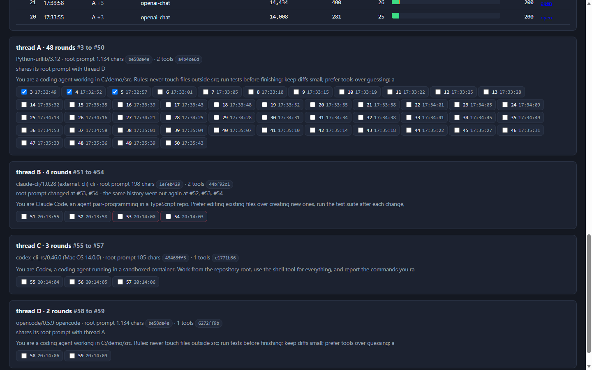

# Watching the context that goes to Strata

One page that sits between your coding agents and a local Strata model and shows
exactly what each agent sent on every round - the whole prompt, the whole answer -
beside the token figures Strata itself counted: context read, prompt-cache reuse,
tokens read new, answer tokens, and how much of the context window each round
filled. The rounds are also grouped into conversations, so you can see which of
them came from the same session, which ran on the same root prompt, and where a
root prompt or a tool set changed part way through.


There is one command, and it is the one that opens the page. Start the capture,
save a capture file, open one again, hide rounds, delete rounds out of a capture
file, and read the context of any round: all of that is a button in the page.

Nothing is capped at a fixed number of rounds - the log keeps every request until
you delete it. Needs only Python 3 (standard library) and PowerShell. Nothing
leaves the machine: the page and the capture talk to Strata on loopback only, and
API keys are masked before anything is written down.

## Quick start

Run this from this folder (`C:\Local Model\Context Monitor`), with Strata already
running:

```powershell
.\Start-ContextMonitor.ps1
```

It opens `http://127.0.0.1:8790/` in your browser and prints the ports:

```
context monitor page (pid 17472): http://127.0.0.1:8790/
capture port for agents: http://127.0.0.1:8788/v1   (Claude Code: ANTHROPIC_BASE_URL=http://127.0.0.1:8788)
```

Then, in the page:

1. press **Start capture** on tab 1 - the capture starts, finds Strata's current
   port by itself, and the page shows which port it picked;
2. point an agent at the capture (the page prints the URL for each kind of agent);
3. watch the rounds arrive line by line, and read them on tabs 3 and 4.

| agent | base URL to use |
|---|---|
| OpenAI-compatible (OpenCode, Cursor, Continue, anything with a custom base URL) | `http://127.0.0.1:8788/v1` |
| Claude Code | `$env:ANTHROPIC_BASE_URL = "http://127.0.0.1:8788"` |
| Codex CLI | `model_base_url = "http://127.0.0.1:8788/v1/responses"` in `config.toml` |

The agents keep working normally: the capture copies the traffic and forwards it
untouched, streaming and tool calls included. Stopping the capture puts Strata
back in the path exactly as it was; the rounds already captured stay readable.

Other page options from the command line, if you want them:

```powershell
.\Start-ContextMonitor.ps1 -CapturePort 9001    # the port agents point at
.\Start-ContextMonitor.ps1 -Port 8899           # the page on another port
.\Start-ContextMonitor.ps1 -Upstream http://127.0.0.1:8080
.\Start-ContextMonitor.ps1 -NoWindow            # start it, open the browser later
```

The capture port does not have to be decided at launch: tab 1 has a **capture port**
box, so you can start the capture on any free port from the page itself.

## Tab 1 - Monitor: start and stop the capture

The top card holds **Start capture**, a **capture port** box and **Stop capture**;
beside them the page says which port is capturing, which Strata port it forwards
to, and how many rounds have gone through. The box holds the port the page was
started with (8788 unless `-CapturePort` said otherwise); type another one and
the capture listens there instead - useful when 8788 is taken, or when you want
a second capture beside it. The agent URLs below follow whichever port you
started on. A capture that is already running has to be stopped before it moves
to another port, and a port something else is already listening on is refused
with a message that says so. A capture that is answering on the port you typed
but was started somewhere else (the command line, another page) is taken over
instead: the page reports it as running and **Stop capture** stops it too. Below: rounds in what you are viewing, how many rounds
the live log holds right now, the biggest context so far as a share of the window,
and how many prompt tokens were reused from the cache against how many were read
new. Then the agent URLs, and a tail of the rounds going by - one line each,
request and answer.

The capture only writes down calls that ask the model for something. Strata's own
page, its fonts and its `/api/` calls come through the same port when you happen
to open the app through the capture; those are skipped, so the rounds are not
buried.

## Tab 2 - Capture files: save one, open one


The top card says what you are looking at - the live log folder, or a capture file
- with its path, how many rounds and conversations are in it, which ones the page
is hiding, and which context window it was taken against.

**Save it as a capture file** writes the rounds you name into one file:

- **newest only** - just the last N rounds;
- **rounds** - a range like `1-20,45`;
- **threads** - whole conversations, like `A,B`;
- **note** - a line that travels with the file;
- **numbers only, no prompt text** - skip the payload files, which makes the file
  tiny and keeps the statistics.

A capture file (`capture-20261020-220650.ctxcap`) is one zip holding the event
lines, the full prompt text and the answers, plus a `manifest.json` that says when
it was taken, what was selected, which window it was measured against, and the
totals. Everything in the page works the same on a capture file as on the live
log, and the header of the round page says where it came from:

```
57 rounds logged · context window 204,800 tokens (Strata's run config strata-iq3_s.json)
  -  opened from the capture saved 2026-10-20T22:06:50-0700
     note: the four demo conversations, saved from the page
```

That is how you move a session to another machine, or hand it to someone else:
save the file, copy it across, and they open it here - **Open** in the list of
capture files. **Unpack to a log folder** turns a capture back into a plain log
folder if you want the raw files, and **show in folder** opens Explorer at the
file. **back to the live log** puts you back on what the capture is writing now.

## Tab 3 - Threads: which rounds are one conversation, and getting rid of ones you do not want



Every conversation gets a card: its letter, how many rounds, the client that sent
it (`claude-cli/1.0.9`, `codex_cli_rs/0.46.0`, and any session headers), the first
thing a person typed in that conversation, the root prompt's length and
fingerprint, and how many tool definitions it carried and their fingerprint. Hold
the mouse over a prompt and a floating box opens with the whole of it: the box is
titled with where the prompt came from, and if it runs past 4,000 characters the
box shows the first 4,000 and says how long it really was. Only what a person
typed goes in that box - system instructions, tool definitions and tool results
never do. Underneath, one chip per round - click the chips to pick rounds.
Hovering a chip opens the same kind of box, titled with the API, the context
size, which round it continues and how many messages were added, whether the same
history went out again, and whether the root prompt changed there, with what the
person asked that round as the text.

Two ways to get rid of rounds:

- **hide from view** - the page stops showing them, in the thread cards, in the
  rounds table and in the Context page. Nothing is removed, and **show hidden
  again** puts them back. Which rounds are hidden is remembered per source, in
  `hidden.json`.
- **delete from the capture file** - rewrites the capture file without those
  rounds and their answers and payload files. The file as it was is kept beside it
  as `NAME.ctxcap.bak-20261020-221347`, and the manifest records what was removed
  and when. The button is disabled while you are looking at the live log, because
  the capture is still writing it - save a capture first, then edit that.

To keep only the rounds that matter, **Save the rounds I picked in Threads**
writes just your selection into a new capture file.

## Tab 4 - Context: the exact context of each round


The Context tab is the round page, built for whatever you are currently viewing
and with the hidden rounds left out. **Rebuild this page** after hiding or
deleting rounds; **Open full size in a new tab** gives the same page on its own,
and the round table's **open** links jump straight into it.

- The table holds **10 rounds per page** and stays put. `10 earlier rounds` /
  `10 later rounds` move a whole page; arrow keys do the same, shift + arrow steps
  one round. A picker above it lists every round, prefixed by its thread letter.
- **show only** beside that picker filters the Context page by conversation: pick a
  thread and the table, its paging and the picker keep just that thread's rounds
  (the pager says how many are left); pick **all threads** to put every round back.
  A thread the filter leaves out is still in the page - the round cards below and the
  conversations table above are never filtered.
- Per round: **context this round** (Strata's count; `est` only when no count came
  back), **cache reused**, **read new**, **answer** tokens, **% of window**, a bar
  for that round inside the window (green = already in the prompt cache, orange =
  read new, red if a context ever exceeds the window), the thread it belongs to -
  its cell shows what the person asked that round, and hovering it opens the
  whole prompt - and how it connects, and the HTTP result.
- Each round's card shows side by side **the exact context that went out** -
  system prompt, tool definitions, every message including tool results - and
  **what the model answered**: text, thinking, tool calls with their arguments.
  Both columns carry token counts as well as characters, long blocks fold, and the
  card names the payload file holding the uncut text.
- **copy**, in the head of every round card and so in the selected-round window below
  the table too, puts the round on the clipboard as plain text: every field the page
  holds - the thread and how the round connects, what the person asked this round, who
  sent it, the time, api, model,
  request, HTTP result, finish, context this round, the window it was measured against,
  percent of it, room left, cache reused, read new, answer tokens, growth, characters,
  messages, tool definitions, root prompt fingerprint, request size, tool calls back,
  and the payload files holding the uncut text - and then every block of context and
  the answer, cut at the same length the page shows them. Paste it into a note, an
  issue, or a text file.


The page reads the window size from Strata's own run config (`--max-context
204800` in `strata-iq3_s.json`), or from the capture file you opened, and states it
once in the header; every percentage and bar is that round against that window.

## How conversations are worked out

An agent that keeps a conversation going sends the whole history again on each
turn, so rounds can be tied together by what they carried. `ctxlink.py` hashes
every request's message list: the hash of its first *k* messages, in order
(tool-call ids are normalised away, so a re-issued call does not break a chain). A
round whose history starts with an earlier round's entire history continues that
round, and the newest match wins - so a retried turn hangs off the round it
retried instead of starting a conversation of its own.

The root (system) prompt and the tool definitions are hashed on their own, and a
second chain is kept over the conversation with the leading system messages
removed, which is what makes the useful things visible:

- **the same conversation** - each round names the round it continues, how many
  messages were shared with it and how many were new;
- **the same root prompt in different conversations** - two agents running on
  identical instructions but unrelated histories stay separate, and each reports
  "shares its root prompt with thread A";
- **a root prompt that changed mid-session** - the history still matches while the
  root-prompt fingerprint does not, and that round is marked;
- **retries and forks** - rounds that sent identical history point at each other,
  and a round that more than one round continues gets called out;
- **who sent it** - the user agent and any app / session headers on the request.


Some Responses-API clients continue a conversation with `previous_response_id`
instead of resending the history; those chain by the answer id the capture
recorded. If the capture has been running since before that was added, stop it and
start it again.

To see the grouping on traffic you did not run: `python demo_threads.py` writes
four pretend conversations into `logs\` - two sharing a root prompt, one retried
turn, one root prompt that changes half way through - and the Threads tab will
show all of it.

## What the numbers mean

The context, reuse and answer figures come from Strata's own `usage` counts, so
they are exact whenever Strata reports them: its OpenAI-compatible route does, the
Anthropic-shaped route does not report cache reuse, which is why that column can
show `-`. The tokens shown per block are Strata's count for that round shared out
over the blocks by size, so the blocks add up to the round's total rather than
being separate guesses. Only where no count came back does anything fall back to
characters, and it is marked `est`. That fallback is worth little on its own: in
one test run the same model measured ~7.9 characters per token on repeated
boilerplate, ~3.1 on prose and code, and ~2.5 on Claude-shaped JSON.

From a 50-round test run against a 204,800-token window:

```
#    time     api          context this round  reused   new  answer  % of window
1    17:32:42 openai-chat  562                0        562  31      0.3%
10   17:33:19 openai-chat  7,212              7,107    105  37      3.5%
50   17:35:43 openai-chat  35,215 (biggest)   34,511   704  39      17.2%
```

## What is written on disk

```
logs\requests.jsonl            one line per request and per answer: model, API shape,
                               estimated system / history / tool-definition tokens, the
                               real usage from Strata, finish reason, answer id. Keys
                               (authorization, x-api-key, api-key) are masked.
logs\payloads\req-NNNNNN.json  the full request body, so the exact context can be read back
logs\payloads\resp-NNNNNN.txt  the answer, captured while it streams: text, thinking, tool
                               calls - so a model restart does not lose it
captures\*.ctxcap              capture files saved from the page
web\report.html                the Context page the page builds
hidden.json                    which rounds each source is hiding from the view
```

None of that is committed to git. The payloads are the bulk of it, so the folder
grows with your session - a busy agent run is a few MB per hour. To start from an
empty log: stop the capture and delete the `logs` folder. To reclaim space but keep
the statistics, save a capture with **numbers only** and delete `logs\payloads`.
If Strata is not reachable, the capture answers 502 and writes that down, so you
notice rather than lose the round silently.

## Under the page

The page is the whole tool, and the launcher is the only thing you need to run.
Start the capture, save and open capture files, hide rounds, delete rounds out of a
capture file, group the rounds into conversations and read the exact context of any
round: every one of those is a button in the page, and there is no separate command
to learn for any of them.

What sits under the page, if you want to read how it works:

- `ctxweb.py` - the page itself, and the only thing the launcher starts; it finds
  Strata's current port, starts and stops the capture, and drives everything below;
- `context_proxy.py` - the capture: it copies the traffic, writes it down with the
  keys masked, and forwards it untouched, streaming and tool calls included;
- `ctxpage.py` - builds the round page: the one on tab 4, and the standalone
  `web\report.html` the page writes beside it;
- `ctxstore.py` - the capture-file format: writing a file, reading one back, listing
  them, and editing one (deleting rounds, remembering which are hidden);
- `ctxlink.py` - works out which rounds are one conversation, and where each round
  came from;
- `demo_threads.py` - four pretend conversations, to try the grouping on traffic you
  did not run.

`ctxstore.py` and `ctxlink.py` are imported by everything else. A capture file
stays readable by whoever has this folder - the format is a zip with a manifest
that says what is in it.

`python test_ports.py` runs the tests for the capture-port box on tab 1: the port
the page asks for, the ones it refuses, and the guards around a port that is busy.

## Which port Strata is on

The Strata **app** listens on a **random loopback port that changes every time it
starts** - during this run `http://127.0.0.1:47831/v1` (its own internal server
answers on a second port, 18500, with an API key). Nothing here hard-codes 8080:
the page probes the loopback listeners, asks each one `/v1/models`, and keeps the
one that answers like Strata; it recognises itself by `/ctx-stats`, so it never
picks the capture as Strata. If it cannot find it, press Start capture again after
starting the model, or pass `-Upstream` to the launcher.

(`run-iq3_s.bat` from the Terminal is the fixed-port alternative:
`C:\Users\v-gulin\AppData\Local\Strata\install\strata-iq3_s.json`, port 8080.)

## Strata's built-in inspector, instead of this capture

Your build can keep the last 100 requests **with their full prompts and answers**
and show them on a page: the `api_monitor` option. It is off here, which is why
`http://127.0.0.1:47831/api/requests` answers 404. To use it:

- `"api_monitor": true` in the run config (`strata-iq3_s.json` on the Terminal
  route), or `--api-monitor` where the server is started, or the **Settings, Model
  settings** card in the app's page;
- restart the model, then open `http://127.0.0.1:<port>/api-monitor`: one row per
  agent request, each row's **Input** being the exact context the agent sent,
  beside Output, Reasoning, the raw response, prompt tokens and timings;
- for scripts: `GET /api/requests` (list) and `GET /api/requests?id=<id>`.

Last 100 requests, **memory only** (gone after a model restart), each cut at
262,144 characters: good for spot checks, not for tracking a whole session. The
ordinary Monitor and `strata monitor` / `strata logs` never show prompt text, by
design. `GET /slots` gives the running request's `n_prompt_tokens` for a context
meter (over `n_ctx`).
